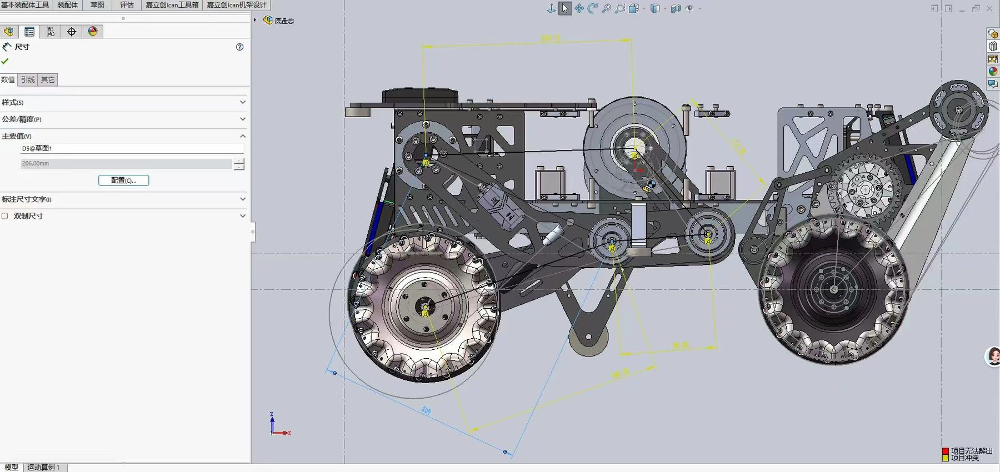
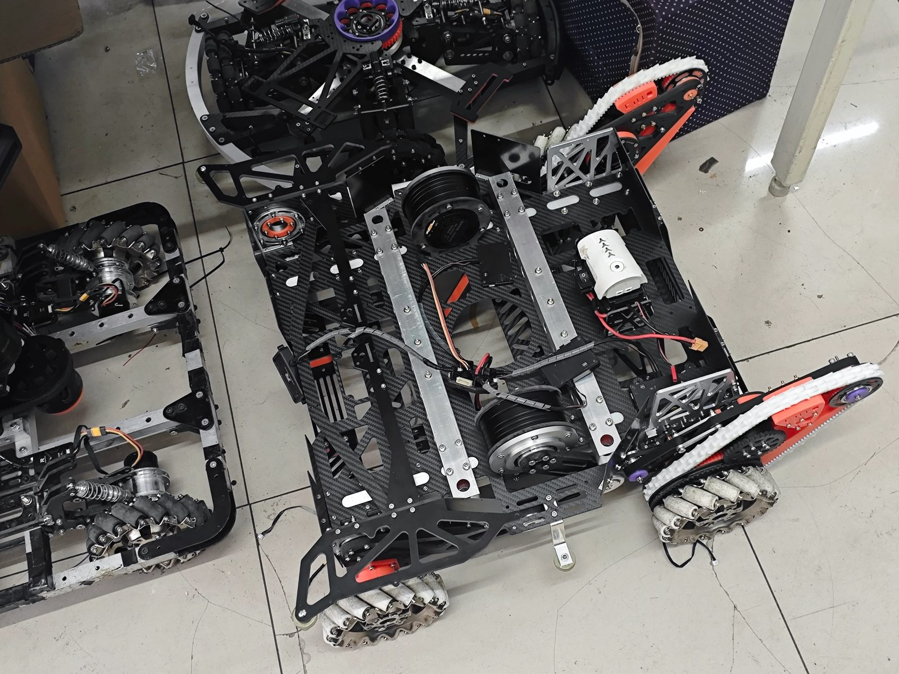
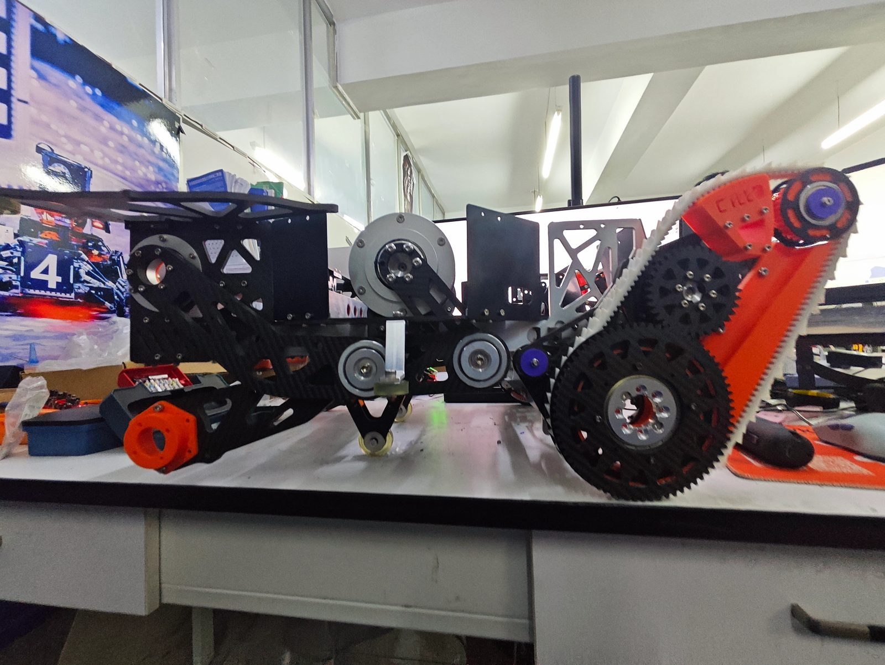
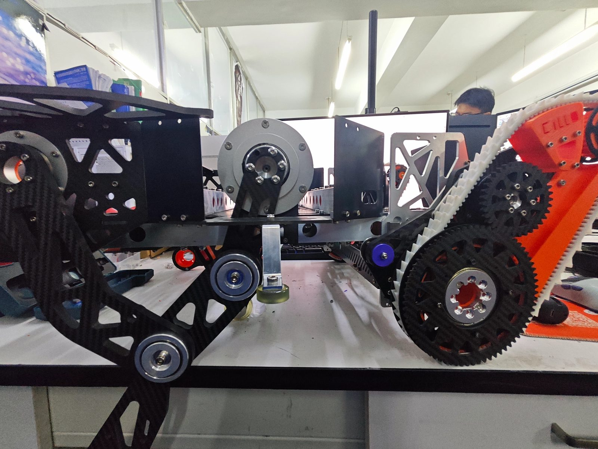

# 重装机器人底盘 · 机械负责人

RoboMaster 机甲大师赛 · 2026.09 – 2026.11

## 背景

重装底盘需要承载重型发射机构，同时受整车重量与安装空间严格约束——悬挂行程和底盘姿态控制很难同时兼顾。

## 核心工作

1. 主导**四连杆独立悬挂**结构设计，采用滑轨滑块直线机构 + 齿轮齿条传动方案，在有限空间内实现悬挂行程与底盘姿态的精准控制；
2. 完成驱动电机扭矩、功率匹配与传动比核算，优化齿轮、同步带轮系布局与张紧策略，降低动力传递损耗；
3. 开展整车**重心计算**与关键结构件仿真，通过 FDM 3D 打印快速打样验证后再投产机加工件。

## 项目成果

- 跨越 200mm 台阶成功率 **90%**，翻转自救成功率 **80%**；
- 大学生创新创业训练计划项目国家级立项入围；
- 第 19 届全国三维数字化创新设计大赛黑龙江赛区获奖。

## 设计过程

SolidWorks 底盘总装侧视图：四连杆悬挂的连杆与摇杆、MGN12 直线导轨、圆柱齿轮 + 同步带传动链和麦克纳姆轮的装配关系，在装配体中直接校核关键尺寸并配合运动算例检查行程与干涉。

## 实车

整车俯拍，碳纤维主框架承载驱动电机与发射机构，线束沿主梁布置，整体布局围绕整车重心收敛。

侧视图可见同步带 + 齿轮两级传动链、张紧轮与悬挂铰接点，橙色件为 FDM 打印的安装限位座，前端装有辅助万向轮。

传动侧另一角度，主从动轮齿数配合、同步带包角与轮系张紧结构在侧板有限空间内完成布局。

## 物料与成本

[整车 BOM](bom-chassis.xlsx)：外购标准件 52 种、定制碳纤 14 种、定制玻纤 19 种、CNC 铝件 17 种、3D 打印自制件 13 种，逐项记录选型规格、数量与参考单价，整车物料成本约 2419 元。
