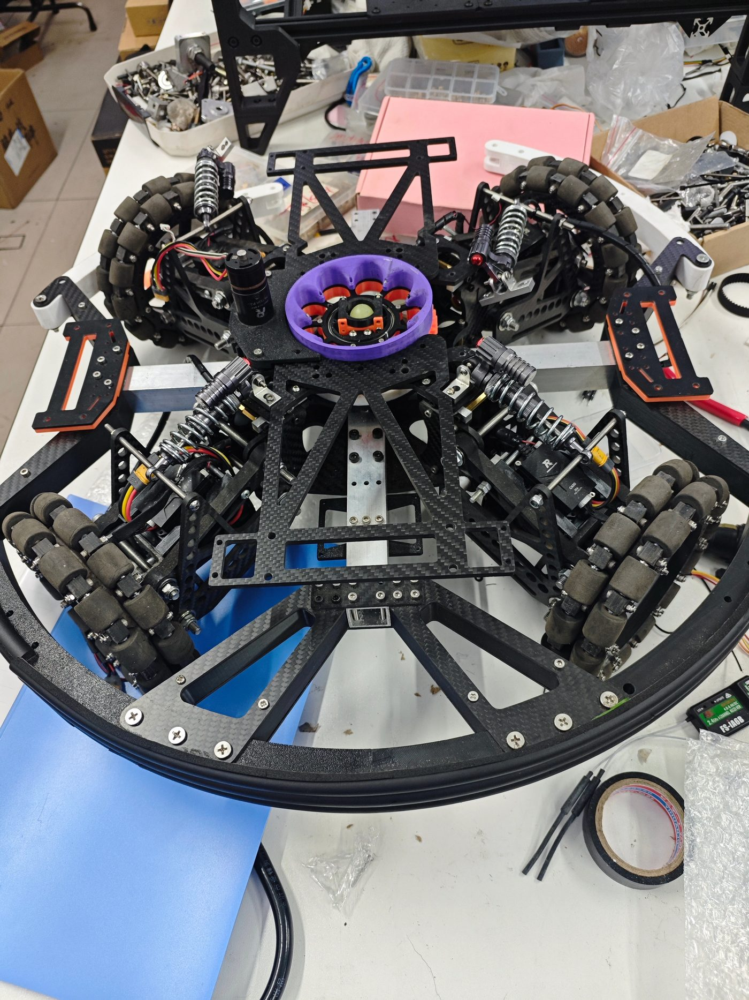

# 步兵机器人 · 机械负责人

RoboMaster 机甲大师赛 · 2025.09 – 2026.07

## 背景

步兵机器人对抗节奏快、转向频繁，传统悬挂抓地力不足、功耗偏高；同时云台转动惯量过大，直接影响响应速度和射击精度。

## 核心工作

1. 基于 MATLAB/Simulink 建立悬挂**二阶系统模型**，通过单位阶跃响应提取最佳阻尼与刚度系数，优化 F-X（力-位移）曲线；
2. 设计**中心供弹拨盘**方案，重构供弹链路布局，让供弹机构与整车重心一起向车体中心收敛；
3. 完成传动部件选型计算与打样验证，协同电控组完成参数联调。

## 项目成果

- 相较传统独立悬挂，抓地力更强、传动功耗更低；
- 整车重心与云台转动惯量降低 **15%**，云台响应与射击精度同步改善；
- RoboMaster 2026 高校联盟赛（东北站）3v3 对抗赛三等奖、步兵对抗赛三等奖。

## 实车

底盘俯拍：四组弹簧独立悬挂围绕中心布置，中间紫色件为中心供弹拨盘，麦克纳姆轮提供全向移动。

